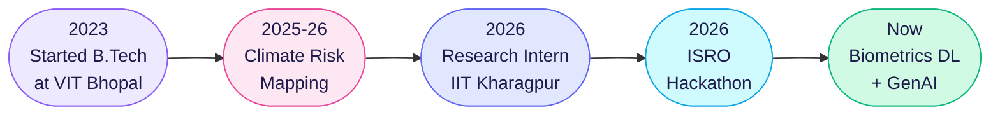

 

  

[About](#-about) · [Experience](#-experience) · [Projects](#-projects) · [Stack](#-tech-stack) · [Stats](#-github-stats) · [Achievements](#-achievements)

---

## 👩‍💻 About

- 🎓 B.Tech Computer Science, **4th year at VIT Bhopal**
- 🧠 Curious about **AI, Machine Learning, Deep Learning and Computer Vision**
- 🚀 Love learning new technologies and **putting them to use** in real projects
- 🔍 Enjoy researching new ideas and digging into how things work
- 🔭 Currently building a behavioral biometrics deep learning model
- 🌱 Currently learning GenAI and AI engineering
- 🎯 Looking for **ML / AI / Computer Vision internships**

---

## 🔬 Experience

**Research Intern** · IIT Kharagpur, Computer Vision & Deep Learning (RCG-SIDM)
*May – June 2026 · Supervisor: Prof. Bharath Haridas Aithal*

- Worked on a **real-time instance segmentation** model, combining state-space modelling, attention and sparse Mixture-of-Experts on top of YOLO
- Trained and benchmarked multiple architectures under identical conditions on NVIDIA GPUs
- Built an automated hyperparameter tuning setup and a unified evaluation pipeline

---

## 🚀 Projects

<table>
<tr>
<td width="33%" valign="top">

### 🌊 FloodLine
AI-powered flood intelligence with multilingual assistance.

`Python` `FastAPI` `Gemini`

</td>
<td width="33%" valign="top">

### 🏙️ Climate Risk Mapping
Random Forest gentrification risk model served via API to an interactive GIS dashboard.

`Python` `FastAPI` `React` `Leaflet`

</td>
<td width="33%" valign="top">

### 🛰️ Crop & Irrigation Advisory
ISRO Bharatiya Antariksh Hackathon 2026 (PS-06) using optical and SAR imagery. *In progress.*

`Sentinel-2` `SAR` `Python`

</td>
</tr>
</table>

<!-- Optional: auto-updating project cards. Replace REPO-NAME with your real repo names.

-->

---

## 🛠️ Tech Stack

---

## 🧭 Journey

---

## 📊 GitHub Stats

<!-- Optional: contribution snake. Needs the GitHub Action from Platane/snk, see setup notes.

  

-->

---

## 🏆 Achievements

- 🏅 Selected from **80,000+ applicants** for an elite Graph Algorithms Camp led by a Codeforces Master
- 🔬 Research Intern at **IIT Kharagpur**
- 🛰️ Participant, **ISRO Bharatiya Antariksh Hackathon 2026**
- ☁️ Certified: **AWS Solutions Architect**, Machine Learning (NPTEL), Fundamentals of AI/ML

<b>🎓 Education</b>

 

**Vellore Institute of Technology, Bhopal**
B.Tech, Computer Science Engineering · 2023 – 2027

Coursework: Data Structures & Algorithms · Operating Systems · Computer Organization & Architecture · DBMS · OOP · Theory of Computation

---

Open to internships and collaborations · <a href="https://www.linkedin.com/in/parvathi-m-a1b684289/">Let's connect</a> · Always learning. Always building. ✨

