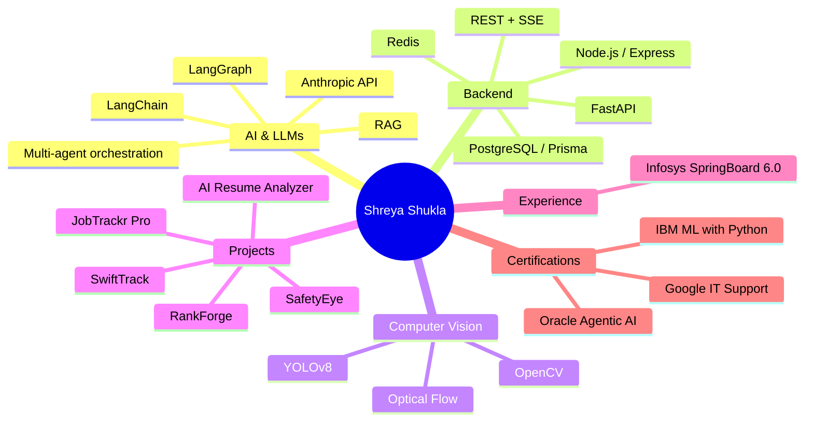

# Hi 👋, I'm Shreya Shukla

[)](https://git.io/typing-svg)

---

## ⭐ About Me

- 🎓 3rd-year B.Tech CSE student at **VIT Bhopal** (CGPA 8.68)
- 🤖 Passionate about **LLM agents, RAG, and AI-driven products**
- ⚙️ I like building **end-to-end systems**: model/agent → backend API → dashboard → deployed demo
- 🚀 Experience with **FastAPI, Node.js, PostgreSQL, React, Docker, LangGraph, LangChain**
- 💡 Currently exploring **semantic search, recommendation/matching, and LLM evals**
- 🎯 Looking for: **SDE / AI Engineer internships**

---

## 🛠️ Tech Stack

**Languages**

**AI / LLMs**

**Backend & Data**

**Frontend & Tools**

---

## 🚀 Featured Projects

### 🧭 JobTrackr Pro: AI-powered job application tracker
Full-featured job application tracking system with LLM features: **job matching, email generation, interview prep** via the Anthropic API.
`Node.js` `Express` `Prisma` `PostgreSQL` `Redis` `React` `Zustand` `TailwindCSS`
👉 [Repo](https://github.com/shreyaashuklaa?tab=repositories) <!-- TODO: replace with the exact JobTrackr Pro repo link -->

### 📄 AI Resume Analyzer *(open-source, in progress)*
Analyzes resumes against job descriptions using Claude, with a FastAPI backend and React frontend.
`FastAPI` `React` `Claude API` `Docker`
👉 [Repo](https://github.com/shreyaashuklaa?tab=repositories) <!-- TODO: replace with the exact repo link -->

### 🦺 SafetyEye: PPE compliance & occupancy monitor
Real-time detection of workers, hardhats and vests in video; flags violations and capacity breaches. Built during **Infosys SpringBoard 6.0**.
- YOLOv8 fine-tuned to **92.4% mAP@50**, plus a vest-verification stage and rule engine that cut false positives in group scenes
- Dashboard with live video overlay, incident alerts, automated PDF/CSV audit reports

`Python` `PyTorch` `YOLOv8` `OpenCV` `FastAPI` `React` `Docker`
[🔗 Code](https://github.com/shreyaashuklaa/safety-eye) · [🌐 Live Demo](https://safety-eye-liard.vercel.app/)

### 🚚 SwiftTrack: Last-mile delivery & dispatch platform
- Admin-configurable **pricing engine** (zones, volumetric weight, B2B/B2C rate cards, COD), all DB-driven, no hardcoded rates
- Auto-assigns the nearest agent using **Haversine distance** + zone affinity + workload
- **Append-only tracking history**, failed-delivery flow, role-based access, live updates via **SSE**

`React` `Node.js` `Express` `SQLite` `JWT` `Leaflet`
[🔗 Code](https://github.com/shreyaashuklaa/last-mile-delivery-tracker) · [🌐 Live Demo](https://last-mile-delivery-xkqo.onrender.com)

### 🏆 RankForge: Contest platform & leaderboard engine
- Contest lifecycle (Upcoming → Live → Ended) with **ICPC-style real-time leaderboard**
- **Async mutex queue** to serialize concurrent submissions and prevent race conditions in scoring
- Monaco Editor + sandboxed code execution with AC / WA / TLE / Runtime Error verdicts

`React 19` `Node.js` `Express` `Monaco Editor`
[🔗 Code](https://github.com/shreyaashuklaa/RankForge) · [🌐 Live Demo](https://rank-forge-eta.vercel.app/)

---

## 🧠 Developer Mindmap

---

## 📈 GitHub Stats

---

## 🎓 Certifications

- Oracle Agentic AI Foundations Associate
- Machine Learning with Python, IBM / Coursera (2025)
- Databases and SQL for Data Science with Python
- Generative AI for Everyone, DeepLearning.AI
- Google IT Support Professional Certificate

---

## 🤝 Let's Connect

I'm open to **SDE / AI engineering internships**. If you're building with LLM agents or backend systems, I'd love to chat.

📫 [shreyashuklak91@gmail.com](mailto:shreyashuklak91@gmail.com) · [LinkedIn](http://www.linkedin.com/in/shreya-shukla-50205b295)

⭐ *If you like something here, drop a star!* ⭐

